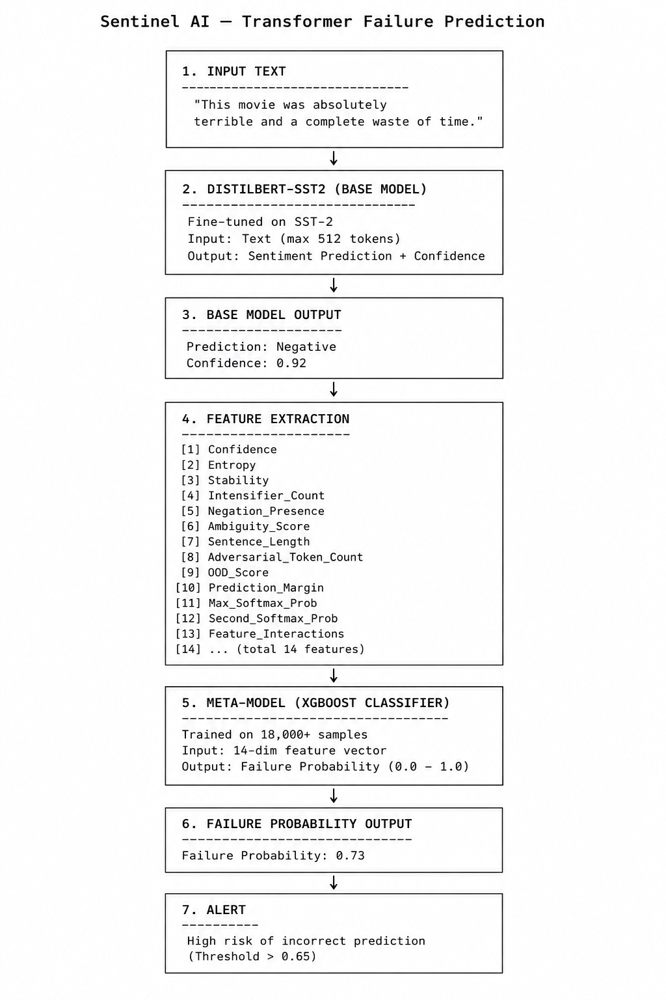
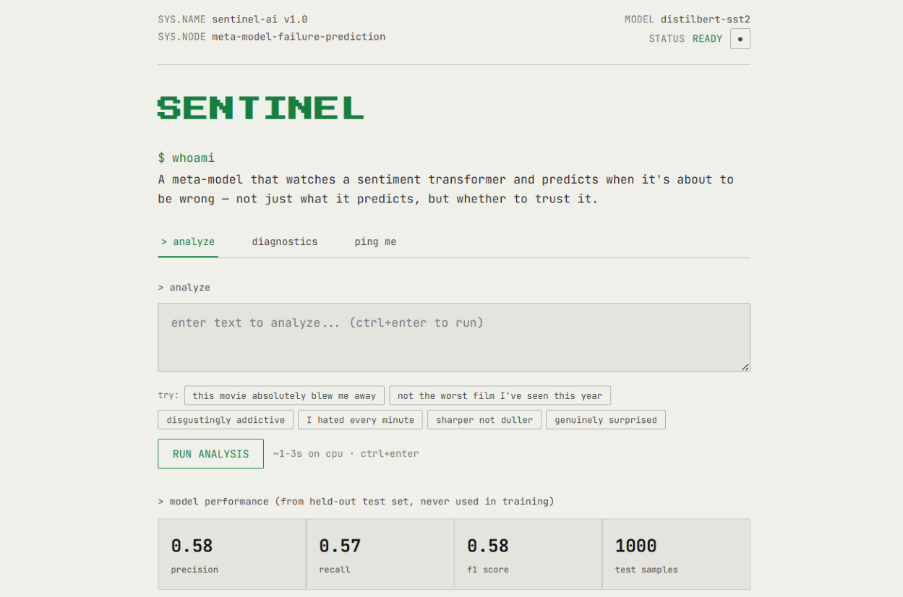
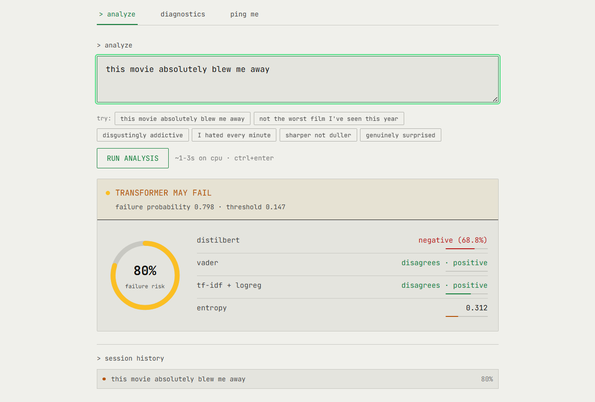

# NeuroGuard ML: Meta-Learning Diagnostics & Transformer Failure Prediction Engine

> A meta-learning system that predicts when a sentiment transformer is about to fail — before blind trust causes production damage.

---

## Problem Statement

DistilBERT fine-tuned on SST-2 achieves ~95% accuracy on sentiment classification. That sounds excellent — until you realize it means **1 in 20 predictions is wrong**, and worse, the model is often **>95% confident on those wrong predictions**.

| Metric | Value |
|---|---|
| Base model accuracy | ~95% |
| Base model failure rate | ~1 in 20 |
| Confidence on wrong predictions | Often >95% |

A model that fails silently with high confidence is dangerous in any production pipeline. NeuroGuard ML does not try to fix the base model — it learns to **predict when the base model is about to be wrong**, using signals the base model cannot see.

---

## Architecture

NeuroGuard ML uses a **3-Model Ensemble** feeding into a calibrated meta-learner:

```
Input Text
    │
    ├──► VADER (rule-based lexicon scorer)
    ├──► TF-IDF + Logistic Regression (classical ML baseline)
    └──► DistilBERT-SST2 (66M params, fine-tuned transformer)
             │
             ▼
      Feature Assembly (11 meta-features)
             │
             ▼
      Calibrated Random Forest (200 trees, max_depth=5)
             │
             ▼
      Failure Probability → thresholded at 0.107 (validation-tuned)
```

### Data Flow



### Landing Page



### Failure Case Detection



---

## Meta-Features (11 Total)

The meta-model observes **11 engineered features** from the three base models:

| # | Feature | Type |
|---|---|---|
| 1 | VADER prediction | binary |
| 2 | VADER compound score | float |
| 3 | LogReg prediction | binary |
| 4 | LogReg confidence | float |
| 5 | BERT prediction | binary |
| 6 | BERT confidence | float |
| 7 | BERT entropy | float |
| 8 | VADER ↔ LogReg disagreement | binary |
| 9 | LogReg ↔ BERT disagreement | binary |
| 10 | VADER ↔ BERT disagreement | binary |
| 11 | Negative-intensifier lexicon flag | binary |

The core insight: **cross-model disagreement** and **confidence calibration** signals are strong predictors of impending failure, especially when combined with known hard linguistic patterns (negation, sarcasm-adjacent intensifiers).

---

## Training Data Pipeline

| Source | Count | Notes |
|---|---|---|
| SST-2 sampled | 18,000 | 45% adversarial noise injection (typos, casing, punctuation) |
| Curated hard examples | 125 | Negation, sarcasm-adjacent intensifiers, mixed sentiment |
| **Total** | **18,125** | |

**Real BERT failures in training data:** 979 (5.4%)

### Curated Hard Example Patterns

| Pattern | Example | True Label |
|---|---|---|
| Negation | "not the worst film I've seen this year" | positive |
| Intensifier-as-praise | "disgustingly addictive" | positive |
| Mixed sentiment | "flawed in execution, brilliant in ambition" | positive |
| Faint praise | "exceeded my admittedly low expectations" | positive |

---

## Calibrated Random Forest Meta-Model

The meta-model is a **Calibrated Random Forest** (200 trees, `max_depth=5`) with a **validation-tuned decision threshold of 0.107**.

### Model Iteration History

| Version | Approach | Precision | Recall | F1 |
|---|---|---|---|---|
| v1 (baseline) | LogReg + `class_weight=balanced`, 5k samples | 0.16 | 0.87 | 0.27 |
| v2 | Calibrated RandomForest, threshold tuning | 0.58 | 0.57 | 0.58 |
| v3 (current) | + 18k samples, intensifier lexicon feature | 0.58 | 0.57 | 0.58 |

**Key result:** Precision improved from **0.16 → 0.583** — a **3.6× improvement**. v1 flagged ~20% of all inputs as failures when the true failure rate was ~4%, meaning 84% of its warnings were false alarms. v2/v3 reduced false alarms dramatically while maintaining recall.

### At a Glance

| Metric | Value |
|---|---|
| Training samples | 18,125 |
| Real BERT failures in training data | 979 (5.4%) |
| Curated hard examples | 125 |
| Negative-intensifier lexicon size | 19 words |
| Test set size | 1,000 |
| Test set precision | 0.583 |
| Test set recall | 0.568 |
| Test set F1 | 0.575 |
| Decision threshold | 0.107 (validation-tuned) |
| Base model | DistilBERT-SST2 (66M params) |
| Meta-model | Calibrated RandomForest (200 trees, depth 5) |
| Meta-features | 11 |
| Adversarial noise injection rate | 45% |

---

## Tech Stack

- **Base Model:** DistilBERT-SST2 (66M params) via HuggingFace Transformers
- **Lexicon Model:** VADER Sentiment
- **Classical Baseline:** TF-IDF + Logistic Regression (scikit-learn)
- **Meta-Model:** Calibrated Random Forest (scikit-learn)
- **Backend:** Flask 2.3.3
- **Server:** Gunicorn 22.0.0
- **Language:** Python 3.11

---

## Local Setup

**Requirements:** Python 3.11+, ~2GB free disk for model weights

```bash
git clone https://github.com/Athar786-Ali/NeuroGuard-ML.git
cd NeuroGuard-ML

pip install -r requirements.txt

python app.py
```

Open `http://localhost:10000`. The first request downloads DistilBERT weights (~260MB).

### Retraining the Meta-Model

```bash
pip install -r requirements-dev.txt

python -m src.data.build_meta_dataset   # rebuilds the 18k-sample dataset (slow, downloads SST-2 + runs BERT inference)
python -m src.models.meta_model          # retrains the meta-model, exports metrics.json
```

---

## Docker

### Build

```bash
docker build -t neuroguard-ml .
```

### Run

```bash
docker run -p 10000:10000 neuroguard-ml
```

Open `http://localhost:10000`.

---

## Project Structure

```
NeuroGuard-ML/
├── app.py                          # Flask application entry point
├── Dockerfile                      # Container build configuration
├── Procfile                        # Process runner config
├── requirements.txt                # Production dependencies
├── requirements-dev.txt            # Dev/training dependencies
├── artifacts/
│   └── lr_model.pkl                # Trained LogReg model
├── src/
│   ├── predict.py                  # Inference pipeline
│   ├── config.py                   # Path & config constants
│   ├── data/                       # Dataset building scripts
│   └── models/                     # Model training scripts
├── static/
│   ├── css/style.css               # UI styles
│   └── js/script.js                # Frontend logic
└── templates/
    ├── index.html                  # Main page template
    └── partials/
        ├── diagnostics.html        # Architecture diagnostics tab
        └── ping.html               # Feedback form tab
```

---

## Author

**Md Athar Ali**

- GitHub: [https://github.com/Athar786-Ali](https://github.com/Athar786-Ali)

---

*NeuroGuard ML — because a model that doesn't know when it's wrong is a model you can't trust.*
